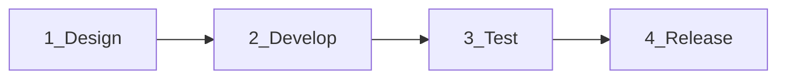

# JobFitly process (design → develop → test → release)

**Single source of truth** for how work moves through the project. Other docs keep deep detail; this page owns the sequence.

| Audience | Start here | Then |
|----------|------------|------|
| Beta testers | [setup.md](setup.md) | Smoke items under [Test → Beta smoke](#3-test) |
| Contributors | This page | [development.md](development.md) · [CONTRIBUTING.md](../CONTRIBUTING.md) |
| Maintainers | This page → [Release](#4-release) | [beta.md](beta.md) for product scope only |

Agent/autofill hard rules live in [`.cursor/skills/jobfitly-dev/`](../.cursor/skills/jobfitly-dev/) — do not invent a second fill path.



---

## 1. Design

Decide **what** and **which layer** before coding.

1. **In scope for beta?** Check [beta.md](beta.md) (supported vs non-goals). Out-of-scope items need an explicit decision, not a quiet PR.
2. **Pick one layer**
   - **Planner / facts** — `backend/` intents, application profile catalog  
   - **Portal DOM** — `extension/src/portalEngine.js` + `extension/src/portals/`  
   - **HITL / Side Panel** — `extension/src/sidepanel/`, `popup/`  
   - **Docs / samples** — `docs/`, `scripts/fake-resumes/`
3. **UX constraints (product)**
   - Never auto-Submit  
   - LLM drafts stay in review (`ask`) before inject  
   - Clear = hide in panel · Delete = remove DB row  
   - Local-first profile (no hosted cloud copies)
4. **Portal / field work** — Prefer kitchen-sink fixtures + [portal-field-coverage.md](portal-field-coverage.md) over inventing a parallel autofill path. One HTML page cannot exercise all ATS hosts (`PortalEngine.detect()` keys off hostname).

---

## 2. Develop

1. Branch from `main` (or the active beta branch).
2. Match stack style: CommonJS in `backend/`; ESM + Vite in `extension/` / `frontend/`.
3. Prefer intent phrases and catalog fields over portal-specific backend branches.
4. Rebuild after UI/DOM changes: `make build-extension` (or `make dev-extension`), then reload unpacked `extension/dist`.
5. No real PII in fixtures, seeds, or screenshots (fictional personas only).
6. Commands / layout / env: [development.md](development.md).

Testers without `make`: [setup.md](setup.md) (`bootstrap.sh` / `start.sh`).

---

## 3. Test

Run **left to right**. Do not skip offline for portal DOM changes.

| Gate | Command / action | When |
|------|------------------|------|
| Stack + unit + offline mocks | `make test-fast` (also pre-commit) | Every PR |
| Kitchen-sink / field sheet | `cd extension && npm test` | Portal control-type changes |
| Playwright fixtures | `cd extension && npm run test:offline` | React-Select / richer DOM |
| Live inject (no Side Panel) | `cd extension && npm run test:e2e` | Portal inject against real boards |
| Live UI matrix | `cd extension && npm run test:e2e:ui` | Upload → capture → Fill Form |
| **Beta smoke (manual)** | See below | Before release / invite |

### Beta smoke (manual)

1. `./scripts/bootstrap.sh` then `./scripts/start.sh` (or regenerate PDFs: `npm run generate:fake-resumes`)
2. Load `extension/dist` · Settings → Groq (preferred) · backend `http://localhost:3000`
3. Upload a fictional PDF from [`samples/resumes/`](samples/resumes/)
4. Analyze + Fill Form on Greenhouse / Lever / Ashby / Workday — **never Submit**
5. Confirm Clear vs Delete

Known product gaps: [beta.md](beta.md). Field-type matrix: [portal-field-coverage.md](portal-field-coverage.md).

**CI:** Manual UI e2e (`.github/workflows/e2e-ui-manual.yml`) needs repo secret **`GROQ_API_KEY`**. Without it, parse can hang on Ollama.

---

## 4. Release

Current beta channel: **unpacked Chrome extension** + local backend. Chrome Web Store is deferred ([beta.md](beta.md)).

1. Working tree clean; `make test-fast` green.
2. Manual beta smoke (above) with Groq preferred.
3. Open or update PR → review → merge to `main` (**delete remote branch** on merge).
4. Optional tag when smoke is boring: e.g. `v0.1.0-beta`.
5. Confirm `GROQ_API_KEY` secret for maintainer UI e2e.
6. Point testers at [setup.md](setup.md) + [beta.md](beta.md). Invite copy can reuse that pair.

### After merge (local)

```bash
git checkout main && git pull
./scripts/start.sh
make build-extension   # if extension changed
# chrome://extensions → Reload
```

---

## Doc map (detail lives elsewhere)

| Topic | Doc |
|-------|-----|
| Install / daily run / troubleshooting | [setup.md](setup.md) |
| Product scope & gaps | [beta.md](beta.md) |
| Make, env, layout | [development.md](development.md) |
| ATS list / adding a portal | [portals.md](portals.md) |
| Control-type greens/reds | [portal-field-coverage.md](portal-field-coverage.md) |
| Groq / Ollama / PII | [llm-and-privacy.md](llm-and-privacy.md) |
| PR etiquette | [CONTRIBUTING.md](../CONTRIBUTING.md) |

When process and a detail doc disagree, **update both** — process owns order; detail docs own how-to.
